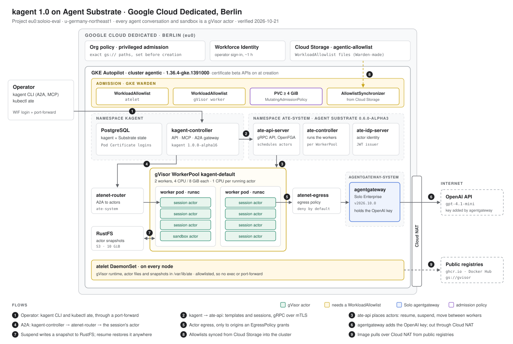

# kagent 1.0 on Agent Substrate in Google Cloud Dedicated



kagent 1.0 runs every agent conversation, and every sandbox, as an Agent
Substrate actor inside its own gVisor sandbox. We built that stack on Google
Cloud Dedicated in Berlin on 21 October 2026 and tested it end to end. This
page covers what GKE Autopilot had to allow, what we tested, and the
configuration to rebuild it. The scripts are in
[`poc/2026-10-kagent-substrate`](../poc/2026-10-kagent-substrate/README.md).

## What's deployed

| Layer | What runs |
|---|---|
| Cloud | Google Cloud Dedicated, Berlin · project `eu0:soloio-eval` · region `u-germany-northeast1` |
| Cluster | GKE Autopilot `1.36.4-gke.1391000`, certificate beta APIs enabled at creation |
| Agent platform | kagent `1.0.0-alpha16` (open source) |
| Agent runtime | Agent Substrate `0.6.0-alpha3`: gVisor sandboxes on two worker pods of 4 CPU / 8 GiB |
| LLM gateway | Solo Enterprise for agentgateway `v2026.10.0`, the only holder of the OpenAI key |
| Model | OpenAI `gpt-4.1-mini`, reached through agentgateway and Cloud NAT |
| Agents | `trustusbank-assistant`, `trustusbank-sandbox-ops`; sandbox templates `trustusbank-scratch`, `trustusbank-egress` |
| Left out | Istio, AgentRegistry, Keycloak and GPUs. GPU workloads are refused at admission. |

## Allowlists

Autopilot admits everything in kagent, Substrate and agentgateway except two
privileged Substrate workloads. Each runs under a WorkloadAllowlist.

| Workload | Why it is privileged | Warden rule | Allowlist |
|---|---|---|---|
| `atelet` DaemonSet, `ate-system` | Substrate's node agent: writes to `/var/lib/ate`, `/var/lib/kubelet/plugins` and `/var/lib/kubelet/device-plugins`, mounts the host's `/dev` | `autogke-no-write-mode-hostpath` | `substrate-atelet-0.6.0-alpha3` |
| gVisor worker Deployment, `kagent/kagent-default` | runs `runsc`, which needs `NET_ADMIN` and `SYS_ADMIN`; writes to `/var/lib/ate` | `autogke-default-linux-capabilities`, `autogke-no-write-mode-hostpath` | `substrate-ateworker-gvisor-0.6.0-alpha3` |

Running as root, atelet's host port, the workers' other eleven capabilities and
their Unconfined seccomp and AppArmor profiles all pass without an exemption.

<details>
<summary>Warden's refusals, as returned</summary>

```text
# GKE Warden refusals of Agent Substrate 0.6.0-alpha3 on GCD Autopilot (1.36.4), before any allowlist
# Captured 2026-10-21. 'Requested by' identity lines removed.

## atelet DaemonSet (server-side dry run, 20-allowlists.sh atelet)
Error from server (GKE Warden constraints violations): error when creating "/Users/thomasorourke/code/google-sov/poc/2026-10-kagent-substrate/deploy/allowlists/atelet-ds-annotated.yaml": admission webhook "warden-validating.common-webhooks.networking.gke.io" denied the request: GKE Warden rejected the request because it violates one or more constraints.
Violations details: {"[denied by autogke-no-write-mode-hostpath]":["hostPath volume ate-base in container atelet is accessed in write mode; disallowed in Autopilot.","hostPath volume kubelet-plugins in container atelet is accessed in write mode; disallowed in Autopilot.","hostPath volume device-plugins in container atelet is accessed in write mode; disallowed in Autopilot.","hostPath volume host-dev used in container atelet uses path /dev which is not allowed in Autopilot. Allowed path prefixes for hostPath volumes are: [/var/log/].","hostPath volume ate-base in container objectstore-plugin is accessed in write mode; disallowed in Autopilot."]}


## gVisor worker Deployment (applied by ate-controller; from its log)
2026-10-21T15:04:07.550106019Z failed to apply Deployment: admission webhook "warden-validating.common-webhooks.networking.gke.io" denied the request: GKE Warden rejected the request because it violates one or more constraints.
Violations details: {"[denied by autogke-default-linux-capabilities]":["linux capability 'NET_ADMIN,SYS_ADMIN' on container 'worker' not allowed; Autopilot only allows the capabilities: 'AUDIT_WRITE,CHOWN,DAC_OVERRIDE,FOWNER,FSETID,KILL,MKNOD,NET_BIND_SERVICE,NET_RAW,SETFCAP,SETGID,SETPCAP,SETUID,SYS_CHROOT,SYS_PTRACE'."],"[denied by autogke-no-write-mode-hostpath]":["hostPath volume ate-base in container worker is accessed in write mode; disallowed in Autopilot."]}
```

</details>

### How the allowlists were made

1. **Authorise the paths first.** Autopilot only accepts an allowlist from a
   bucket path listed exactly in the org policy and in the cluster's
   `autopilot_privileged_admission`. Adding one later costs a ~20 minute
   cluster update, so the paths, and two spares, were set at creation.
2. **Let Warden write it.** With `cloud.google.com/generate-allowlist: "true"`
   on the pod template, Warden still refuses the pod, but its refusal carries a
   WorkloadAllowlist for that exact spec. atelet's came from a server-side dry
   run of the rendered chart; the workers' from the `ate-controller` log,
   because that controller creates them.
3. **Upload and sync.** Each file goes to
   `gs://agentic-allowlist/substrate/0.6.0-alpha3/` and an
   `AllowlistSynchronizer` installs it. The synchronizer only re-reads a file
   when its own spec changes, so the script reorders the path list to force it.
4. **Live with `no-connect`.** Allowlisted pods can't be exec'd or
   port-forwarded; logs still work. Anything that changes either pod, such as a
   new Substrate version, means generating both allowlists again.

[`scripts/20-allowlists.sh`](../poc/2026-10-kagent-substrate/scripts/20-allowlists.sh) does all four.

## Other changes GCD needed

| Problem | Fix |
|---|---|
| Substrate needs PodCertificateRequest and ClusterTrustBundle, which are beta on 1.36, the newest version in Berlin | enable both when the cluster is created; GKE ignores a later change |
| Hyperdisk Balanced is the only disk type and starts at 4 GiB, but `kagent install` asks for 500 Mi | a MutatingAdmissionPolicy raises small claims to 4 GiB |
| Autopilot stored the RustFS bucket Job with a higher CPU request than the chart sets, so every later upgrade failed on the Job's immutable template | `rustfs.bucketInit.resources` set to what Autopilot stores |
| `kubectl ate` is refused: `kagent install` makes only kagent's controller an owner of Substrate's API | an `ate-operator` service account added as a bootstrap owner |
| No GPUs on this cluster | a ValidatingAdmissionPolicy refuses accelerator requests and accelerator node selectors |
| No nested virtualisation on Autopilot | gVisor only; Substrate's microVM class can't run |

## Tests

Run against the cluster on 21 October 2026. Evidence is in
[`evidence/`](../poc/2026-10-kagent-substrate/evidence/).

| Test | Result | Evidence |
|---|---|---|
| Certificate beta APIs served | Pass | [cluster](../poc/2026-10-kagent-substrate/evidence/cluster-2026-10-21.txt) |
| Substrate without allowlists | Refused, as above | [refusals](../poc/2026-10-kagent-substrate/evidence/warden-refusals-2026-10-21.txt) |
| Control plane, atelet and workers running under their allowlists | Pass | [verify](../poc/2026-10-kagent-substrate/evidence/verify-2026-10-21T1622Z.txt) |
| GPU pod refused | Pass | [verify](../poc/2026-10-kagent-substrate/evidence/verify-2026-10-21T1622Z.txt) |
| agentgateway supplies the OpenAI key to a request sent with a dummy one | Pass, HTTP 200 | [script](../poc/2026-10-kagent-substrate/scripts/30-agentgateway.sh) |
| Agent answers through agentgateway | Pass | [verify](../poc/2026-10-kagent-substrate/evidence/verify-2026-10-21T1622Z.txt) |
| Sandbox runs on gVisor's kernel, not the node's | Pass: `Linux 4.19.0-gvisor`, node `6.12.105+` | [verify](../poc/2026-10-kagent-substrate/evidence/verify-2026-10-21T1622Z.txt) |
| A file survives suspend and resume | Pass | [verify](../poc/2026-10-kagent-substrate/evidence/verify-2026-10-21T1622Z.txt) |
| An agent runs a command in a sandbox through kagent's MCP tools | Pass | [verify](../poc/2026-10-kagent-substrate/evidence/verify-2026-10-21T1622Z.txt) |
| Substrate's API through `kubectl ate` | Pass as `ate-operator`; the default identity is refused | [api](../poc/2026-10-kagent-substrate/evidence/substrate-api-2026-10-21.txt) |
| 20 conversations at once, two rounds, three runs | Pass: 8 run at a time (4 per worker), all 40 answered every run, resume p50 343–357 ms | [report](../poc/2026-10-kagent-substrate/evidence/multiplex-2026-10-21T1635Z/report.txt) |
| A request when no worker is free | Pass: refused at once and retried by the kagent CLI; none failed | [report](../poc/2026-10-kagent-substrate/evidence/multiplex-2026-10-21T1635Z/report.txt) |
| An actor resumes on the other worker | Pass: 5 to 10 of 20 per run, conversation intact | [report](../poc/2026-10-kagent-substrate/evidence/multiplex-2026-10-21T1635Z/report.txt) |
| Checkpoint and fork | Pass: the fork knows only what came before the checkpoint | [fork](../poc/2026-10-kagent-substrate/evidence/checkpoint-fork-2026-10-21.txt) |
| EgressPolicy | Pass: nothing reachable by default; one origin opened in a running sandbox | [run](../poc/2026-10-kagent-substrate/evidence/behaviours-2026-10-21T1635Z.txt) |
| `kagent install` re-run over the live install | Pass, twice | [reinstall](../poc/2026-10-kagent-substrate/evidence/reinstall-2026-10-21.txt) |
| microVM sandbox class | Not possible on Autopilot | |

Re-run them with `scripts/60-verify.sh` (13 checks) and
`scripts/70-substrate-behaviours.sh` (22).

## Deploying it

Run order, once the cluster exists: `10-cluster.sh` → `15-gpu-guard.sh` →
`20-allowlists.sh atelet` → `30-agentgateway.sh` → `40-kagent.sh` →
`50-agents.sh` → `60-verify.sh` → `70-substrate-behaviours.sh`, or
[`run-all.sh`](../poc/2026-10-kagent-substrate/scripts/run-all.sh). Secrets
(`AGENTGATEWAY_LICENSE_KEY`, `OPENAI_API_KEY`) come from the environment.
Paths below are relative to `poc/2026-10-kagent-substrate/`.

<details>
<summary><b>Cluster</b> · OpenTofu profile and module</summary>

[`infra/tofu/profiles/gcd-autopilot.tfvars`](../infra/tofu/profiles/gcd-autopilot.tfvars), excerpt:

```hcl
cluster_name = "agentic"
# 2026-10-21 rebuild for kagent 1.0 on Agent Substrate (poc/2026-10-kagent-substrate).
# Substrate needs the PodCertificateRequest and ClusterTrustBundle APIs: GA and
# served by default on 1.37, beta on 1.36. Berlin offers nothing newer than
# 1.36.4-gke.1391000 (the RAPID default), so this pins that build and enables
# both beta APIs below. RAPID is still not where a customer-facing environment
# should live; it is here because no other channel has 1.36 as its default.
release_channel    = "RAPID"
min_master_version = "1.36.4-gke.1391000"

# Creation-time only: GKE ignores a later change, so editing this means
# recreating the cluster. Empty it once Berlin serves 1.37.
k8s_beta_apis = [
  "certificates.k8s.io/v1beta1/podcertificaterequests",
  "certificates.k8s.io/v1beta1/clustertrustbundles",
]

# Agent Substrate's atelet DaemonSet and gVisor worker pods, admitted through
# WorkloadAllowlists that poc/2026-10-kagent-substrate generates. Each path must
# also be in the org policy (that lab's allowlists/orgpolicy-*.yaml), and must
# be set here at creation to avoid a ~20 minute cluster update. The spares are
# authorised but empty until needed. Istio's paths are gone: no mesh this time.
autopilot_privileged_admission = [
  "gke://*",
  "gs://agentic-allowlist/substrate/0.6.0-alpha3/atelet.yaml",
  "gs://agentic-allowlist/substrate/0.6.0-alpha3/ateworker-gvisor.yaml",
  "gs://agentic-allowlist/substrate/spare-1.yaml",
  "gs://agentic-allowlist/substrate/spare-2.yaml",
]
```

[`infra/tofu/modules/gke-autopilot/main.tf`](../infra/tofu/modules/gke-autopilot/main.tf), excerpt:

```hcl
resource "google_container_cluster" "this" {
  enable_autopilot               = true
  autopilot_privileged_admission = var.autopilot_privileged_admission

  # GKE honours this only at CREATION: added later, the update succeeds and
  # the APIs are still not served, so the cluster has to be recreated.
  dynamic "enable_k8s_beta_apis" {
    for_each = length(var.k8s_beta_apis) > 0 ? [1] : []
    content {
      enabled_apis = var.k8s_beta_apis
    }
  }
  # ...
}
```

The replace command that recreates the cluster is in the header of
[`scripts/10-cluster.sh`](../poc/2026-10-kagent-substrate/scripts/10-cluster.sh).

</details>

<details>
<summary><b>Org policy</b> · allowlist paths · <code>allowlists/orgpolicy-autopilot-privileged-admission.yaml</code></summary>

Applied with `gcloud org-policies set-policy`. The `istio/` paths belong to the
earlier ambient lab.

```yaml
# Organisation-scoped: this affects every GKE cluster in the org.
#
# Extends the policy 63-allowlist-install.sh wrote for Istio rather than
# replacing it. Paths are EXACT objects; a directory prefix is not honoured
# (feedback/google/evidence/berlin-allowlist-path-prefix-not-honoured-2026-09-04.txt).
#
#   istio/...                      the earlier ambient lab, kept so it can rebuild
#   substrate/0.6.0-alpha3/...     Agent Substrate: atelet DaemonSet, gVisor workers
#   substrate/spare-*.yaml         authorised in advance, unused until needed: adding
#                                  a path later costs an org policy edit plus a
#                                  ~20 minute cluster update
#
# allowAnyGKEPath: true keeps GKE's own partner allowlists. Do not change it.
name: organizations/560780939237871/policies/container.managed.autopilotPrivilegedAdmission
spec:
  rules:
    - enforce: true
      parameters:
        allowAnyGKEPath: true
        allowPaths:
          - gs://agentic-allowlist/istio/1.30.4/istio-cni.yaml
          - gs://agentic-allowlist/istio/1.30.4/istio-ztunnel.yaml
          - gs://agentic-allowlist/substrate/0.6.0-alpha3/atelet.yaml
          - gs://agentic-allowlist/substrate/0.6.0-alpha3/ateworker-gvisor.yaml
          - gs://agentic-allowlist/substrate/spare-1.yaml
          - gs://agentic-allowlist/substrate/spare-2.yaml
```

</details>

<details>
<summary><b>GPU guard</b> · <code>yaml/gpu-guard.yaml</code></summary>

```yaml
# No GPUs on this cluster, enforced rather than merely absent.
#
# Autopilot provisions an accelerator node for any pod that asks for one: the
# previous cluster ran an a3-edgegpu-8g-nolssd (H100) node for Gemma around the
# clock. With no Node pools to remove, the only cluster-side lever is admission,
# so this policy refuses any workload that requests an accelerator resource or
# selects accelerator nodes.
#
# Checked on the workload objects as well as Pods so a Deployment is refused at
# `kubectl apply`, where someone will see it, rather than only as a ReplicaSet
# event. GKE's own namespaces are exempt so the policy can never block a
# managed component.
apiVersion: admissionregistration.k8s.io/v1
kind: ValidatingAdmissionPolicy
metadata:
  name: deny-gpu-workloads
spec:
  failurePolicy: Fail
  matchConstraints:
    resourceRules:
      - apiGroups: [""]
        apiVersions: ["v1"]
        operations: ["CREATE", "UPDATE"]
        resources: ["pods"]
      - apiGroups: ["apps"]
        apiVersions: ["v1"]
        operations: ["CREATE", "UPDATE"]
        resources: ["deployments", "statefulsets", "daemonsets", "replicasets"]
      - apiGroups: ["batch"]
        apiVersions: ["v1"]
        operations: ["CREATE", "UPDATE"]
        resources: ["jobs", "cronjobs"]
  matchConditions:
    - name: not-a-gke-managed-namespace
      expression: >-
        !(request.namespace in ['kube-system', 'kube-public', 'kube-node-lease', 'gmp-system', 'gmp-public'])
        && !request.namespace.startsWith('gke-')
  variables:
    - name: podSpec
      expression: >-
        object.kind == 'Pod' ? object.spec :
        object.kind == 'CronJob' ? object.spec.jobTemplate.spec.template.spec :
        object.spec.template.spec
    - name: containers
      expression: >-
        variables.podSpec.containers +
        (has(variables.podSpec.initContainers) ? variables.podSpec.initContainers : [])
    - name: acceleratorResource
      expression: >-
        ['nvidia.com/', 'amd.com/', 'google.com/tpu']
  validations:
    - expression: >-
        variables.containers.all(c,
          !has(c.resources) || (
            (!has(c.resources.limits) || !c.resources.limits.exists(k,
              variables.acceleratorResource.exists(p, k.startsWith(p)))) &&
            (!has(c.resources.requests) || !c.resources.requests.exists(k,
              variables.acceleratorResource.exists(p, k.startsWith(p))))))
      reason: Forbidden
      message: >-
        GPU access is disabled on this cluster: containers may not request
        accelerator resources (nvidia.com/*, amd.com/*, google.com/tpu).
    - expression: >-
        !has(variables.podSpec.nodeSelector) ||
        !variables.podSpec.nodeSelector.exists(k,
          k in ['cloud.google.com/gke-accelerator', 'cloud.google.com/gke-tpu-accelerator',
                'cloud.google.com/gke-accelerator-count'])
      reason: Forbidden
      message: >-
        GPU access is disabled on this cluster: workloads may not select
        accelerator nodes.
---
apiVersion: admissionregistration.k8s.io/v1
kind: ValidatingAdmissionPolicyBinding
metadata:
  name: deny-gpu-workloads
spec:
  policyName: deny-gpu-workloads
  validationActions: [Deny]
```

</details>

<details>
<summary><b>PVC floor</b> for Hyperdisk · <code>yaml/pvc-floor.yaml</code></summary>

```yaml
# Hyperdisk Balanced is the only disk type in GCD, and it has a 4 GiB floor:
# a smaller claim fails with "Volume provisioning failed with infeasible error
# ... InvalidArgument" and the pod waits for ever. `kagent install` creates its
# development PostgreSQL with a 500Mi claim (fine on kind, impossible here).
#
# This raises any claim below the floor to the floor at creation, and makes a
# later attempt to shrink a claim (the CLI re-applying its 500Mi manifest on a
# re-run) a no-op instead of an error. MutatingAdmissionPolicy is GA in 1.36.
apiVersion: admissionregistration.k8s.io/v1
kind: MutatingAdmissionPolicy
metadata:
  name: hyperdisk-pvc-floor
spec:
  failurePolicy: Fail
  reinvocationPolicy: IfNeeded
  matchConstraints:
    resourceRules:
      - apiGroups: [""]
        apiVersions: ["v1"]
        operations: ["CREATE", "UPDATE"]
        resources: ["persistentvolumeclaims"]
  matchConditions:
    - name: not-a-gke-managed-namespace
      expression: >-
        !(request.namespace in ['kube-system', 'kube-public', 'gmp-system', 'gmp-public'])
        && !request.namespace.startsWith('gke-')
    - name: has-storage-request
      expression: >-
        has(object.spec.resources) && has(object.spec.resources.requests)
        && 'storage' in object.spec.resources.requests
  variables:
    - name: requested
      expression: string(object.spec.resources.requests['storage'])
    - name: previous
      expression: >-
        request.operation == 'UPDATE' && oldObject != null && has(oldObject.spec.resources)
        && has(oldObject.spec.resources.requests) && 'storage' in oldObject.spec.resources.requests
        ? string(oldObject.spec.resources.requests['storage']) : ''
    # Raise only at CREATE. On UPDATE a claim's request may not grow unless it
    # is bound, so raising an existing claim would make EVERY update to it fail,
    # finalizer removal included: the claim could then never be deleted. On
    # UPDATE, only turn a shrink back into "unchanged".
    - name: target
      expression: >-
        request.operation == 'CREATE'
        ? (quantity(variables.requested).isLessThan(quantity('4Gi')) ? '4Gi' : '')
        : (variables.previous != '' && quantity(variables.requested).isLessThan(quantity(variables.previous))
           ? variables.previous : '')
  mutations:
    - patchType: JSONPatch
      jsonPatch:
        expression: >-
          variables.target == '' ? [] :
          [JSONPatch{op: 'replace', path: '/spec/resources/requests/storage', value: variables.target}]
---
apiVersion: admissionregistration.k8s.io/v1
kind: MutatingAdmissionPolicyBinding
metadata:
  name: hyperdisk-pvc-floor
spec:
  policyName: hyperdisk-pvc-floor
```

</details>

<details>
<summary><b>agentgateway</b> · Helm install and <code>yaml/agentgateway.yaml</code></summary>

```bash
kubectl apply --server-side --force-conflicts \
  -f https://github.com/kubernetes-sigs/gateway-api/releases/download/v1.6.1/standard-install.yaml
CHARTS=oci://us-docker.pkg.dev/solo-public/enterprise-agentgateway/charts
helm upgrade --install enterprise-agentgateway-crds $CHARTS/enterprise-agentgateway-crds \
  -n agentgateway-system --create-namespace --version v2026.10.0 --wait
helm upgrade --install enterprise-agentgateway $CHARTS/enterprise-agentgateway \
  -n agentgateway-system --version v2026.10.0 \
  --set-string licensing.licenseKey="$AGENTGATEWAY_LICENSE_KEY" --wait
# The only copy of the OpenAI key; agentgateway sends it upstream verbatim.
kubectl -n agentgateway-system create secret generic openai-secret \
  --from-literal=Authorization="Bearer $OPENAI_API_KEY"
```

Gateway, backend and route. [`30-agentgateway.sh`](../poc/2026-10-kagent-substrate/scripts/30-agentgateway.sh)
replaces `__OPENAI_MODEL__` with `gpt-4.1-mini`.

```yaml
# agentgateway in front of the model: the one governed hop between every agent
# actor and the LLM. With no GPUs on this cluster the model is OpenAI, reached
# over Cloud NAT; the API key exists only in the openai-secret Secret below
# (created by 30-agentgateway.sh) and the gateway adds it upstream. Agents send
# a placeholder.
#
# ClusterIP only. Agents reach it in-cluster; nothing here needs a public IP.
apiVersion: enterpriseagentgateway.solo.io/v1alpha1
kind: EnterpriseAgentgatewayParameters
metadata:
  name: agentgateway-proxy
  namespace: agentgateway-system
spec:
  service:
    spec:
      type: ClusterIP
  deployment:
    metadata:
      labels:
        company: trustusbank
    spec:
      template:
        metadata:
          labels:
            company: trustusbank
---
apiVersion: gateway.networking.k8s.io/v1
kind: Gateway
metadata:
  name: agentgateway-proxy
  namespace: agentgateway-system
spec:
  gatewayClassName: enterprise-agentgateway
  infrastructure:
    parametersRef:
      group: enterpriseagentgateway.solo.io
      kind: EnterpriseAgentgatewayParameters
      name: agentgateway-proxy
  listeners:
    - name: http
      protocol: HTTP
      port: 80
      allowedRoutes:
        namespaces: { from: All }
---
apiVersion: agentgateway.dev/v1alpha1
kind: AgentgatewayBackend
metadata:
  name: openai
  namespace: agentgateway-system
spec:
  ai:
    provider:
      openai:
        # Pinned here, so a caller cannot switch itself onto a pricier model.
        model: __OPENAI_MODEL__
  policies:
    auth:
      secretRef:
        name: openai-secret
---
# OpenAI-shaped path: kagent's OpenAI clients post to <baseUrl>/chat/completions
# with baseUrl .../v1 (yaml/kagent-values.yaml, yaml/agents.yaml).
apiVersion: gateway.networking.k8s.io/v1
kind: HTTPRoute
metadata:
  name: openai
  namespace: agentgateway-system
spec:
  parentRefs:
    - name: agentgateway-proxy
  rules:
    - matches:
        - path: { type: PathPrefix, value: /v1 }
      backendRefs:
        - group: agentgateway.dev
          kind: AgentgatewayBackend
          name: openai
```

</details>

<details>
<summary><b>WorkloadAllowlist</b> for atelet · <code>allowlists/atelet.yaml</code></summary>

Generated by Warden; don't edit by hand. Install it before `kagent install`.

```yaml
apiVersion: auto.gke.io/v1
kind: WorkloadAllowlist
metadata:
    name: substrate-atelet-0.6.0-alpha3
    annotations:
        autopilot.gke.io/no-connect: "true"
exemptions:
    - autogke-no-write-mode-hostpath
matchingCriteria:
    initContainers:
        - name: objectstore-plugin
          image: ghcr.io/kagent-dev/substrate/objectstore-plugin:v0.6.0-alpha3
          args:
            - node
            - --socket=/run/objectstore-plugin/node.sock
            - --root=/var/lib/ate
            - --asset-staging-dir=/var/lib/objectstore-plugin/asset-staging
            - --asset-staging-capacity=8Gi
          env:
            - name: ATE_STORAGE_BACKEND
            - name: AWS_REGION
            - name: AWS_ENDPOINT_URL
            - name: AWS_S3_USE_PATH_STYLE
            - name: AWS_ACCESS_KEY_ID
            - name: AWS_SECRET_ACCESS_KEY
          securityContext:
            capabilities:
                drop:
                    - ALL
          startupProbe:
            exec:
                command:
                    - /ko-app/objectstore-plugin
                    - healthcheck
                    - --socket=/run/objectstore-plugin/node.sock
          volumeMounts:
            - mountPath: /var/lib/ate
              name: ate-base
            - mountPath: /run/objectstore-plugin
              name: objectstore-plugin
            - mountPath: /var/lib/objectstore-plugin/asset-staging
              name: asset-staging
    containers:
        - name: atelet
          image: ghcr.io/kagent-dev/substrate/atelet:v0.6.0-alpha3
          args:
            - --preview=
            - --objectstore-plugin-socket=/run/objectstore-plugin/node.sock
            - --grpc-server-cred-bundle=/run/podidentity.podcert.ate.dev/credential-bundle.pem
            - --client-ca-certs=/run/podidentity.podcert.ate.dev/trust-bundle.pem
            - --ateapi-ca-file=/run/servicedns.podcert.ate.dev/trust-bundle.pem
          env:
            - name: NODE_NAME
            - name: POD_NAME
            - name: POD_NAMESPACE
            - name: POD_UID
            - name: OTEL_RESOURCE_ATTRIBUTES
          securityContext:
            capabilities:
                add:
                    - DAC_OVERRIDE
                drop:
                    - ALL
          volumeMounts:
            - mountPath: /run/objectstore-plugin
              name: objectstore-plugin
            - mountPath: /var/lib/ate
              name: ate-base
            - mountPath: /run/podidentity.podcert.ate.dev
              name: podidentity
              readOnly: true
            - mountPath: /run/servicedns.podcert.ate.dev
              name: servicedns-ca
              readOnly: true
            - mountPath: /var/lib/kubelet/plugins
              name: kubelet-plugins
            - mountPath: /var/lib/kubelet/device-plugins
              name: device-plugins
            - mountPath: /host/dev
              name: host-dev
              readOnly: true
    volumes:
        - name: objectstore-plugin
        - name: asset-staging
        - hostPath:
            path: /var/lib/ate
          name: ate-base
        - hostPath:
            path: /var/lib/kubelet/plugins
          name: kubelet-plugins
        - hostPath:
            path: /var/lib/kubelet/device-plugins
          name: device-plugins
        - hostPath:
            path: /dev
          name: host-dev
        - name: podidentity
        - name: servicedns-ca
```

</details>

<details>
<summary><b>WorkloadAllowlist</b> for the gVisor worker · <code>allowlists/ateworker-gvisor.yaml</code></summary>

Generated by Warden from the `ate-controller` log after `kagent install`.

```yaml
apiVersion: auto.gke.io/v1
kind: WorkloadAllowlist
metadata:
    name: substrate-ateworker-gvisor-0.6.0-alpha3
    annotations:
        autopilot.gke.io/no-connect: "true"
exemptions:
    - autogke-default-linux-capabilities
    - autogke-no-write-mode-hostpath
matchingCriteria:
    containers:
        - name: worker
          image: ghcr.io/kagent-dev/substrate/ateworker-gvisor:v0.6.0-alpha3
          args:
            - --pod-uid=$(POD_UID)
            - --atunnel-listen-address=:443
            - --atunnel-connect-listen-address=:8443
            - --atunnel-credential-bundle=/run/podidentity.podcert.ate.dev/credential-bundle.pem
            - --atunnel-trust-bundle=/run/podidentity.podcert.ate.dev/trust-bundle.pem
            - --atunnel-client-identity=spiffe://cluster.local/ns/ate-system/sa/atenet-router
            - --atunnel-egress-listen-address=0.0.0.0:15001
            - --atunnel-egress-trust-bundle=/run/servicedns.podcert.ate.dev/trust-bundle.pem
            - --dns-egress-policy=enforce-in-atunnel
            - --preview=
          env:
            - name: POD_UID
            - name: POD_NAMESPACE
            - name: WORKER_POOL_NAME
          securityContext:
            appArmorProfile:
                type: Unconfined
            capabilities:
                add:
                    - NET_ADMIN
                    - SYS_ADMIN
                    - SYS_CHROOT
                    - SYS_PTRACE
                    - SETUID
                    - SETGID
                    - SETPCAP
                    - DAC_OVERRIDE
                    - FOWNER
                    - CHOWN
                    - MKNOD
                    - NET_RAW
                    - SETFCAP
                drop:
                    - ALL
            privileged: false
          volumeMounts:
            - mountPath: /run/worker-capacity
              name: worker-capacity
              readOnly: true
            - mountPath: /var/lib/ate
              name: ate-base
            - mountPath: /run/podidentity.podcert.ate.dev
              name: atunnel-identity
              readOnly: true
            - mountPath: /run/servicedns.podcert.ate.dev
              name: atunnel-egress-trust
              readOnly: true
    volumes:
        - name: worker-capacity
        - hostPath:
            path: /var/lib/ate
          name: ate-base
        - name: atunnel-identity
        - name: atunnel-egress-trust
```

</details>

<details>
<summary><b>AllowlistSynchronizer</b> · <code>allowlists/allowlistsynchronizer.yaml</code></summary>

```yaml
apiVersion: auto.gke.io/v1
kind: AllowlistSynchronizer
metadata:
  name: substrate
spec:
  projectNumber: 560780937444745
  bucketName: agentic-allowlist
  allowlistPaths:
    - substrate/0.6.0-alpha3/atelet.yaml
    - substrate/0.6.0-alpha3/ateworker-gvisor.yaml
```

</details>

<details>
<summary><b>kagent install</b> · command and <code>yaml/kagent-cli-config.yaml</code></summary>

`kagent install` installs kagent's and Substrate's CRDs, Substrate's CAs, the
Pod Certificate controller, a development PostgreSQL, Substrate in
`ate-system`, and kagent with a gVisor WorkerPool.

```bash
kubectl apply -f yaml/pvc-floor.yaml       # before the installer's PostgreSQL claim
OPENAI_API_KEY=placeholder-the-key-is-in-agentgateway \
  kagent --config yaml/kagent-cli-config.yaml install --namespace kagent
kubectl apply -f yaml/ate-operator.yaml
```

```yaml
# kagent CLI configuration for `kagent install` (scripts/40-kagent.sh).
# Paths are relative to this file. No secrets here: the CLI reads the provider
# key from the environment, and 40-kagent.sh passes a placeholder because the
# real OpenAI key lives only in agentgateway.
install:
  defaultModelProvider: OpenAI
  kagent:
    valuesFiles: [kagent-values.yaml]
  substrate:
    valuesFiles: [substrate-values.yaml]
```

</details>

<details>
<summary><b>kagent values</b> · <code>yaml/kagent-values.yaml</code></summary>

```yaml
# kagent 1.0 chart values, applied by `kagent install` over its own defaults.

providers:
  openAI:
    # The generated default ModelConfig goes through agentgateway, which holds
    # the real OpenAI key and adds it upstream. The kagent-openai Secret only
    # ever holds a placeholder. Full DNS name: Substrate only resolves names
    # that match an actor's egress policy, and short names are not inferred.
    config:
      baseUrl: http://agentgateway-proxy.agentgateway-system.svc.cluster.local/v1

config:
  sandboxes:
    # Standalone sandboxes need a digest-pinned guest; empty disables them.
    guestImage: ghcr.io/kagent-dev/kagent/sandbox-guest@sha256:d3c444e3f5472598ff520255b72cfcb9ecdf22815fd87747315aeaf0520801c3

substrateWorkerPool:
  # Worker pods host the gVisor sandboxes. Each actor reserves its runtime
  # limits (1 CPU / 1 GiB by default) out of its worker's own limits, which
  # atelet reads through the downward API, so the pod size IS the capacity.
  replicas: 2
  template:
    annotations:
      # GKE Warden returns a ready-made WorkloadAllowlist in its rejection when
      # the pod carries this. The worker Deployment is created at runtime by
      # Substrate's controller, so this is how 20-allowlists.sh gets the exact
      # spec. Harmless once an allowlist admits the pod.
      cloud.google.com/generate-allowlist: "true"
    resources:
      requests:
        cpu: "2"
        memory: 4Gi
      limits:
        cpu: "4"
        memory: 8Gi

# Needs a Grafana this cluster does not have, and pulls from Docker Hub.
grafana-mcp:
  enabled: false
```

</details>

<details>
<summary><b>Substrate values</b> · <code>yaml/substrate-values.yaml</code>, and what <code>kagent install</code> adds</summary>

Neither setting here reaches the atelet pod, so its allowlist stands.

```yaml
# Agent Substrate chart values. Read by `kagent install` (through
# kagent-cli-config.yaml) AND by 20-allowlists.sh, which renders the chart with
# these exact values to generate the atelet WorkloadAllowlist. Change anything
# that reaches the atelet pod (image, args, env, volumes, security context) and
# the allowlist must be regenerated, or GKE Warden rejects the DaemonSet.

rustfs:
  # Snapshot store for actors. Hyperdisk Balanced is the only disk type in GCD
  # and has a 4 GiB floor; ask for something the CSI driver will not round.
  storageSize: 10Gi
  bucketInit:
    # Exactly what Autopilot stores for the bucket Job. Its minimum CPU request
    # is 50m, so it raised the chart's 10m at creation; a Job's pod template is
    # immutable, so every later upgrade of this release (a re-run of `kagent
    # install` included) failed on the completed Job until the two matched.
    resources:
      requests: { cpu: 50m, memory: 128Mi, ephemeral-storage: 1Gi }
      limits: { cpu: 500m, memory: 256Mi, ephemeral-storage: 1Gi }

ateApi:
  authorization:
    # Principals that always hold `owner` on Substrate's global scope. `kagent
    # install` sets only kagent's controller (its Pod Certificate SPIFFE ID);
    # a values file replaces that list, so it is repeated here. The second is
    # an operator identity for `kubectl ate`: a ServiceAccount
    # (yaml/ate-operator.yaml) whose token only cluster admins can mint. The
    # shared `ate-client` fallback that `kubectl ate` uses without
    # --token-file is deliberately NOT an owner (Substrate's own advice outside
    # development). Only ate-api-server's flags change; atelet is unaffected,
    # so its allowlist stands.
    bootstrapOwners:
      - spiffe://cluster.local/ns/kagent/sa/kagent-controller
      - system:serviceaccount:ate-system:ate-operator
```

`kagent install` adds these itself, before the values files (from kagent's
`install.go`). A values file replaces a list, which is why the controller is
repeated in `bootstrapOwners` above.

```yaml
# Substrate release
ateApi:
  authorization:
    bootstrapOwners:
      - "spiffe://cluster.local/ns/kagent/sa/kagent-controller"
credentialProvider:
  namespacePolicies:
    - atespace: "kagent"
      allowedNamespaces: ["kagent"]
# kagent release
substrateWorkerPool:
  create: true
  workerImage: "ghcr.io/kagent-dev/substrate/ateworker-gvisor:v0.6.0-alpha3"
```

To change Substrate's values later without re-running the installer:

```bash
helm upgrade substrate oci://ghcr.io/kagent-dev/substrate/helm/substrate --version 0.6.0-alpha3 \
  -n ate-system --reuse-values -f yaml/substrate-values.yaml --wait
```

</details>

<details>
<summary><b>Operator account</b> for <code>kubectl ate</code> · <code>yaml/ate-operator.yaml</code></summary>

```yaml
# The operator identity for Substrate's own API (`kubectl ate`).
#
# ate-api-server authenticates a Kubernetes ServiceAccount token as
# `system:serviceaccount:<namespace>:<name>` and authorises it through OpenFGA.
# yaml/substrate-values.yaml makes this account a bootstrap owner. Its power is
# gated by Kubernetes RBAC: minting a token needs `create` on
# serviceaccounts/token in ate-system, which only cluster admins hold.
#
#   kubectl -n ate-system create token ate-operator \
#     --audience api.ate-system.svc --duration 10m > op.token
#   kubectl ate --token-file op.token get atespaces
apiVersion: v1
kind: ServiceAccount
metadata:
  name: ate-operator
  namespace: ate-system
  labels:
    app.kubernetes.io/part-of: kagent-substrate-lab
```

</details>

<details>
<summary><b>Agents and sandbox template</b> · <code>yaml/agents.yaml</code></summary>

```yaml
# Agents and actors for the kagent 1.0 / Agent Substrate test.
#
# Every agent on the Berlin cluster is named trustusbank-*. In kagent 1.0 an
# Agent pairs portable behaviour (an inline template here) with a Harness, which
# says how it runs. Substrate compiles each revision into an ActorTemplate,
# boots a golden actor and snapshots it; every conversation (a Session) is then
# an actor restored from that snapshot onto a gVisor worker, and suspended to
# the snapshot store when idle.

# How these agents run: the Go ADK (kagent's own runtime; the release's pinned
# golang-adk image) on the gVisor pool, snapshots in the in-cluster RustFS
# bucket Substrate installs. The Go runtime is used rather than Python because
# a Go binary restores cleanly from a snapshot across workers.
apiVersion: api.kagent.dev/v1alpha3
kind: Harness
metadata:
  name: trustusbank-go
  namespace: kagent
spec:
  kagent: {}
  substrate:
    workerPoolRef:
      name: kagent-default
    snapshotPolicy:
      location: s3://ate-snapshots/kagent
---
apiVersion: api.kagent.dev/v1alpha3
kind: Agent
metadata:
  name: trustusbank-assistant
  namespace: kagent
spec:
  harnessRef:
    name: trustusbank-go
  template:
    inline:
      # default-model-config: OpenAI through agentgateway (yaml/kagent-values.yaml).
      modelConfig:
        name: default-model-config
      description: TrustUsBank's general assistant, running as a Substrate actor in a gVisor sandbox.
      systemPrompt: |
        You are the TrustUsBank assistant. TrustUsBank AG is a German bank, and
        you run inside its sovereign platform on Google Cloud Dedicated in
        Berlin. Answer briefly and precisely. If you do not know something, say so.
---
# The scratch environment a sandbox gets: a tools image (digest-pinned, as
# kagent requires) with kagent's guest supplied as the entrypoint. No egress:
# a sandbox with no EgressPolicy reaches nothing.
apiVersion: api.kagent.dev/v1alpha3
kind: SandboxTemplate
metadata:
  name: trustusbank-scratch
  namespace: kagent
spec:
  workload:
    image: docker.io/library/alpine:3.22@sha256:5291449c3df73caf6ed85e649dec1b9e818b39a5d8c871e97afc13e9cd5e8fa8
  env:
    - name: LANG
      value: C.UTF-8
  substrate:
    workerPoolRef:
      name: kagent-default
    snapshotPolicy:
      location: s3://ate-snapshots/sandboxes
---
# An agent that creates and drives sandboxes through kagent's own MCP API.
# Asking it to inspect its environment is the in-agent gVisor proof: the
# commands run in a separate gVisor-sandboxed actor and report gVisor's kernel.
apiVersion: api.kagent.dev/v1alpha3
kind: Agent
metadata:
  name: trustusbank-sandbox-ops
  namespace: kagent
spec:
  harnessRef:
    name: trustusbank-go
  template:
    inline:
      modelConfig:
        name: default-model-config
      description: Runs shell commands for TrustUsBank engineers in short-lived, gVisor-isolated sandboxes.
      systemPrompt: |
        You run shell commands for TrustUsBank engineers in isolated sandboxes.
        To run a command: call create_sandbox with namespace "kagent", template
        "trustusbank-scratch" and a fresh request_id; start the command as a
        process with command ["sh", "-c", "<command>"]; poll get_sandbox_process
        until it has finished; read_sandbox_outputs; then delete_sandbox. Report
        the command output verbatim in a code block, then one sentence on what
        it shows.
      tools:
        - mcp:
            server:
              kind: RemoteMCPServer
              name: kagent-api
            tools:
              - list_sandbox_templates
              - create_sandbox
              - get_sandbox
              - start_sandbox_process
              - get_sandbox_process
              - read_sandbox_outputs
              - delete_sandbox
```

</details>

<details>
<summary><b>EgressPolicy</b> · <code>yaml/egress.yaml</code></summary>

```yaml
# EgressPolicy test (scripts/70-substrate-behaviours.sh egress).
#
# A sandbox reaches nothing unless an EgressPolicy grants it: Substrate's egress
# gateway (atenet-egress) admits only listed HTTP(S) origins, and names that no
# policy lists do not even resolve. kagent turns an EgressPolicy referenced
# from a SandboxTemplate (or an Agent) into the Substrate egress policy of each
# actor; changing the references updates running sandboxes without a restart.
#
# The template is applied WITHOUT the reference. The script proves the deny,
# then adds `egressPolicyRefs`, and proves one origin opens while another stays
# closed, in the same running sandbox.
apiVersion: api.kagent.dev/v1alpha3
kind: EgressPolicy
metadata:
  name: trustusbank-egress-example
  namespace: kagent
spec:
  destinations:
    - origin: https://example.com
---
apiVersion: api.kagent.dev/v1alpha3
kind: SandboxTemplate
metadata:
  name: trustusbank-egress
  namespace: kagent
spec:
  workload:
    image: docker.io/library/alpine:3.22@sha256:5291449c3df73caf6ed85e649dec1b9e818b39a5d8c871e97afc13e9cd5e8fa8
  substrate:
    workerPoolRef:
      name: kagent-default
    snapshotPolicy:
      location: s3://ate-snapshots/sandboxes
```

Grant it to the template; running sandboxes pick it up without a restart:

```bash
kubectl -n kagent patch sandboxtemplate trustusbank-egress --type merge \
  -p '{"spec":{"egressPolicyRefs":[{"name":"trustusbank-egress-example"}]}}'
```

</details>

<details>
<summary><b>Using it</b> · kagent CLI, <code>kubectl ate</code>, checkpoints and forks</summary>

```bash
export KUBECONFIG=$PWD/deploy/.kubeconfig
# Any free local port. Not 8083: it is the kagent CLI's default URL, and a local
# server or stale forward there makes the CLI talk to something else, silently.
PORT=28083
kubectl -n kagent port-forward svc/kagent-controller $PORT:8083 &
kagent() { ~/.cache/kagent/1.0.0-alpha16/kagent --api-url http://127.0.0.1:$PORT --gateway-url http://127.0.0.1:$PORT "$@"; }
SID=$(kagent agent session create --agent trustusbank-assistant -o json | jq -r .session.id)
kagent agent invoke --session "$SID" --task "Hello"
kagent sandbox create trustusbank-scratch --request-id demo-1
kagent sandbox exec <id> -- sh -c 'uname -sr; dmesg | head'

# Substrate's own view, as the operator. scripts/lib.sh (ate_cli) builds kubectl-ate from the
# v0.6.0-alpha3 tag into ~/.cache/kagent-substrate-lab/substrate-0.6.0-alpha3/; on PATH it is `kubectl ate`.
kubectl -n ate-system create token ate-operator --audience api.ate-system.svc --duration 30m > op.token
kubectl ate --token-file op.token get actors -A
kubectl ate --token-file op.token get workers

# Checkpoints and forks are MCP tools on kagent-controller (/mcp); the CLI has no command for them
scripts/kagent_mcp.py http://127.0.0.1:$PORT call create_session_checkpoint \
  '{"session_id":"<sid>","expected_head_task_id":"<task id>"}'
scripts/kagent_mcp.py http://127.0.0.1:$PORT call fork_session '{"checkpoint_id":"<checkpoint id>"}'
```

</details>
