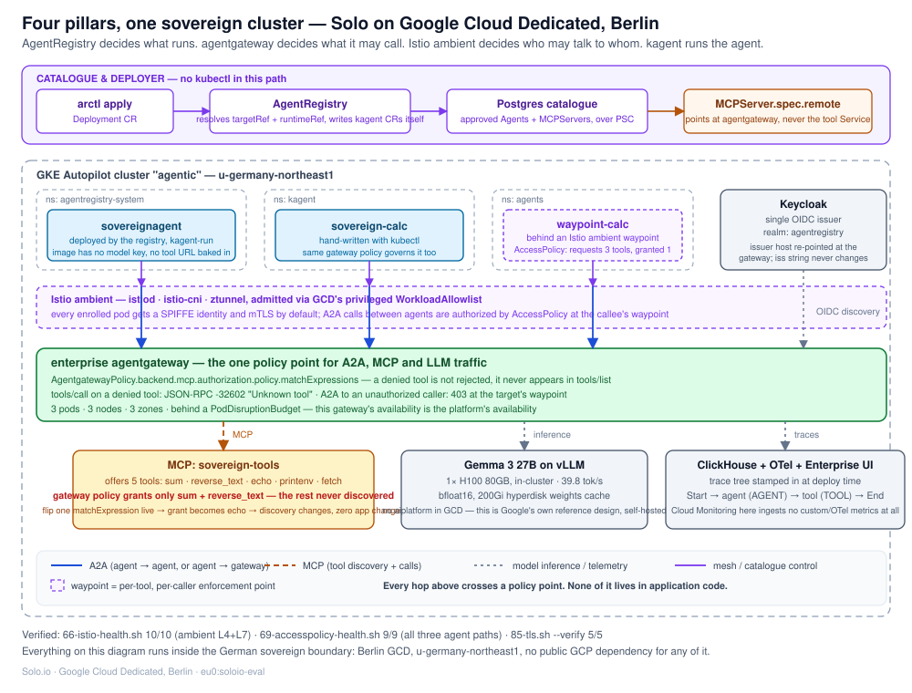

# The sovereign agentic platform: a story for Google

**Audience: Google.** This is the story we want to tell about what Solo has
built on Google Cloud Dedicated (GCD), Berlin — a preview universe, not a GCP
region — and why four pieces (AgentRegistry, agentgateway, kagent, Istio
ambient) have to exist together for an agent platform to be governable at all.

The one-sentence version: **AgentRegistry decides what runs. agentgateway
decides what it may call. Istio ambient decides who may talk to whom. kagent
runs the agent.** No single one of those is a governance story on its own —
together they are.



---

## Why this needed four things, not one

A platform team asked to "let developers run agents safely" tends to reach
for one control and stop. The problem is that each control answers a
different question, and a regulator, auditor, or security review will ask all
four:

| Question | Who answers it | If missing |
|---|---|---|
| What is allowed to exist in this cluster at all? | **AgentRegistry** | Anyone with kubectl can run anything |
| What can a running agent actually call? | **agentgateway** | An agent's capability is whatever the prompt says it is |
| Which workloads may even reach each other on the network? | **Istio ambient** | Any pod can talk to any pod; identity is a claim, not a fact |
| What runs the agent loop itself, and where does it report? | **kagent** | No consistent runtime, no consistent trace |

We built all four because a demo that only shows one of them invites the
question "what about the other three ways to get around this?" — and on GCD,
where the platform team also had to fight for the mesh to be deployable at
all (see below), showing all four is the difference between "a proof of
concept" and "a platform."

---

## The three agent paths, side by side

The cluster runs three agents at once, on purpose, so the same demo can show
escalating layers of control without changing the story:

| | Path A — `sovereign-calc` | Path B — `sovereignagent` | Path C — `waypoint-calc` |
|---|---|---|---|
| Namespace | `kagent` | `agentregistry-system` | `agents` |
| How it got there | Hand-written, `kubectl apply` | **AgentRegistry deployed it — no kubectl** | Behind an Istio ambient waypoint |
| Governed by | `AgentgatewayPolicy` at the standalone gateway | The *same* `AgentgatewayPolicy` | `AccessPolicy`, compiled to L7 gateway policy **and** L4 `AuthorizationPolicy` |
| What it proves | The gateway enforces policy with no mesh at all | The catalogue governs an agent the platform team never touched | The mesh enforces per-tool, per-caller access even before the gateway sees the call |

Path C is the interesting assertion, and it's the one we prove rather than
claim: the agent is configured to *request* three tools, the `AccessPolicy`
grants it one, and the test is that it must be able to call `sum` and must
be unable to even discover `echo`. If the agent definition simply omitted
the other tools, this would prove nothing — the point is the agent asks for
capability it doesn't get, and the platform is what removes it, not the
agent's own good behavior.

Verified: `66-istio-health.sh` 10/10 (ambient L4 + L7), `69-accesspolicy-health.sh`
9/9 (all three paths above), `85-tls.sh --verify` 5/5.

---

## Act by act

### 1. AgentRegistry: the catalogue is the thing that deploys

The naive version of a catalogue is a wiki page describing what's approved.
Ours is an `ar.dev/v1alpha1 Deployment` object:

```yaml
apiVersion: ar.dev/v1alpha1
kind: Deployment
metadata:
  name: sovereignagent-kagent
spec:
  targetRef:  { kind: Agent,   name: sovereignagent }
  runtimeRef: { kind: Runtime, name: kubernetes-default }
  env:
    OPENAI_BASE_URL: http://llm.agentic.eu0.internal/v1
    OPENAI_API_KEY: sovereign-local-noauth
    MCP_SERVERS_CONFIG: '[{"name":"sovereign-tools","type":"remote","url":"http://mcp.agentic.eu0.internal/mcp"}]'
```

`arctl apply -f` this, and AgentRegistry resolves `targetRef` to the
catalogued `Agent` and `runtimeRef` to a registered runtime, then **creates
the kagent `Agent` CR itself**, using its own in-cluster ServiceAccount.
kagent's controller takes it from there and produces the Deployment and
Service. Nobody runs `kubectl`. The registry is the only writer — that's the
governance boundary an auditor cares about: a developer publishes to the
catalogue, and the platform, not the developer, decides what reaches a
cluster.

Notice what's *not* in the image: no model endpoint, no API key, no tool URL.
Those three lines above are injected at deploy time. The same built artifact
is portable to any runtime the registry knows, with no rebuild and no
embedded credential — which is also why a compromised image can't leak a
credential it never had.

The tool server is catalogued the same way, and this is the line that makes
the whole thing govern by construction rather than by policy:

```yaml
apiVersion: ar.dev/v1alpha1
kind: MCPServer
metadata:
  name: sovereign-tools
spec:
  remote:
    type: http
    url: http://mcp.agentic.eu0.internal/mcp   # agentgateway, never the tool's own Service
```

Every agent that consumes this catalogue entry reaches the tools through
agentgateway. There is no path to the tool server that bypasses the policy
point, because the catalogue never hands out one.

### 2. agentgateway: the one policy point for A2A, MCP, and LLM traffic

agentgateway sits in front of every tool call, every agent-to-agent
delegation, and every call to the model. Its policy is a `matchExpressions`
list scoped to tool names:

```yaml
backend.mcp.authorization.policy.matchExpressions:
  - mcp.tool.name in ["sum", "reverse_text"]
```

The tool server actually offers five tools: `sum`, `reverse_text`, `echo`,
`printenv`, `fetch`. A denied tool isn't rejected — it never appears in
`tools/list` at all. Call it anyway and you get JSON-RPC `-32602 "Unknown
tool"`. This matters for the demo because you can flip the grant live —
change the match expression to include `echo` instead of `reverse_text` —
and the agent's visible capability changes with zero code change, zero
redeploy, and zero touch to the agent or the tool server.

The gateway is a real data plane, not a sidecar convenience: 3 pods, 3 nodes,
3 zones, behind a PodDisruptionBudget. On this platform, the gateway's
availability *is* the platform's availability, so it's built like it.

### 3. Istio ambient: identity and mesh-level enforcement

This is the piece that almost didn't exist. GKE Autopilot rejects the
privileged DaemonSets any service mesh needs (`istio-cni`, `ztunnel`), and
GCD had no Cloud Service Mesh and no GKE NetworkPolicy to fall back on. As of
2026-09-04, GCD shipped privileged workload allowlisting
(`WorkloadAllowlist` / `AllowlistSynchronizer`), which is what let us admit
ambient's control and data plane at all. Before that date, this section of
the story didn't exist — worth saying to Google directly, since it's their
own platform change that unblocked it.

With ambient running, every enrolled pod gets a SPIFFE identity and mTLS by
default, and `AccessPolicy` gives per-tool, per-caller enforcement at the
callee's waypoint — compiled down into both an L7 `AgentgatewayPolicy` and an
L4 Istio `AuthorizationPolicy`, so the same intent is enforced at two layers
independently. That's Path C above.

### 4. kagent: the thing that actually runs the agent

kagent is the constant across all three paths — the controller that turns an
`Agent` CR into a running workload and a `RemoteMCPServer` binding into a
live tool connection, whether the `Agent` CR was written by a person with
`kubectl` or by AgentRegistry with neither person nor `kubectl` involved.
It's also where the model connection lives: a `ModelConfig` CRD pointed at
agentgateway's LLM route rather than at the model's own Service, so
agent-to-model traffic is a governed, audited hop like everything else —
the same architectural argument as the MCP server, applied to inference.

---

## The model: self-hosted, in the boundary, and now on GPU

There's no Vertex AI in GCD, so inference has to be self-hosted inside the
sovereign boundary — this is Google's own reference design for this
environment, not a workaround. As of 2026-09-18, that's **Gemma 3 27B on
vLLM, on a single H100 80GB**, verified at **39.8 tok/s**, served through the
same `agentgateway` LLM route described above. Getting there required
clearing three real defects (ephemeral-storage pod eviction from unpinned
weight downloads, a CPU-RAM OOM during weight materialization before GPU
transfer, and a silent vLLM float16 downcast that produced HTTP 200 responses
with an empty `message.content` — fixed by explicitly pinning
`--dtype=bfloat16`), on top of the GPU-provisioning fight itself: H100s in
this universe would not schedule until the ComputeClass listed zone `-b`
before zone `-a` (a status Google's own side had listed as "should be
available" while it plainly was not — `feedback/google/06`). All three fixes
and the provisioning breakthrough are dated 2026-09-18 and reproducible from
this repo's commit history.

The platform's default model profile is still the small CPU path
(Qwen2.5-3B-Instruct on llama.cpp, chosen originally because it's ungated on
Hugging Face and GCD has no secret manager to hold a gated model's token) —
both profiles exist, selected by `MODEL_PROFILE=cpu|gpu`. For a Google-facing
demo, GPU/Gemma is the one to show: it's the sovereignty argument (no
external inference dependency) *and* the performance argument (fast enough to
matter) at the same time.

---

## TrustUsBank: the same mechanism, in a regulated scenario

The platform argument above is abstract until it's applied to something a
regulator would actually ask about. TrustUsBank AG is a fictional German
bank; the lab runs SEPA Instant fraud triage across three agents that split
work the way a financial-crime desk's access control actually splits it:

| Agent | Role | May call | Cannot call |
|---|---|---|---|
| `payment-triage` | orchestrator | `create_case` | `file_sar` |
| `fraud-analysis` | fraud desk | `get_account`, `list_transactions` | `get_customer` |
| `sanctions-screening` | sanctions desk | `screen_sanctions`, `check_pep` | anything on core-banking |

Each agent is deliberately configured to *ask for* a tool it doesn't get —
same principle as Path C above, applied to a real workflow. `fraud-analysis`
reaches a verdict on a payment without ever being able to read the customer
record; no agent can file the regulatory report, so the GwG §43 filing stays
with a named compliance officer; A2A calls are authorized per-caller at the
target's own waypoint, so `sanctions-screening → fraud-analysis` gets 403 and
`payment-triage → fraud-analysis` gets 200. `./scripts/health.sh` runs 23
checks proving all of this by attempting to break it, not by asserting it.
Full write-up: `docs/trustusbank-sepa-fraud-triage.md`.

---

## What we want Google to take from this

1. **The mesh being deployable at all is a GCD platform change, not a Solo
   one** — privileged workload allowlisting, shipped 2026-09-04, is what let
   Istio ambient run on Autopilot here. Worth Google knowing their own fix
   unlocked this.
2. **GPU scheduling was broken past the point Google's own status said it
   worked**, and the fix (zone ordering in the ComputeClass) is narrow and
   reproducible. We have H100s running Gemma 3 27B today.
3. **The governance story only holds together with all four pieces.** Show
   only agentgateway and the question is "what stops someone bypassing it at
   the network layer" (Istio answers that). Show only Istio and the question
   is "what stops an agent asking for a tool it's not supposed to have"
   (agentgateway answers that). Show only kagent and the question is "who
   decided this should be running" (AgentRegistry answers that).
4. **Everything above runs inside the German sovereign boundary** — Berlin
   GCD, `u-germany-northeast1`, no public GCP dependency for any component in
   this story, model included.

For the live walkthrough of this material — hosts-file setup, exact
commands, timing, and a Q&A/reset section — see `docs/demo-runbook.md`.
